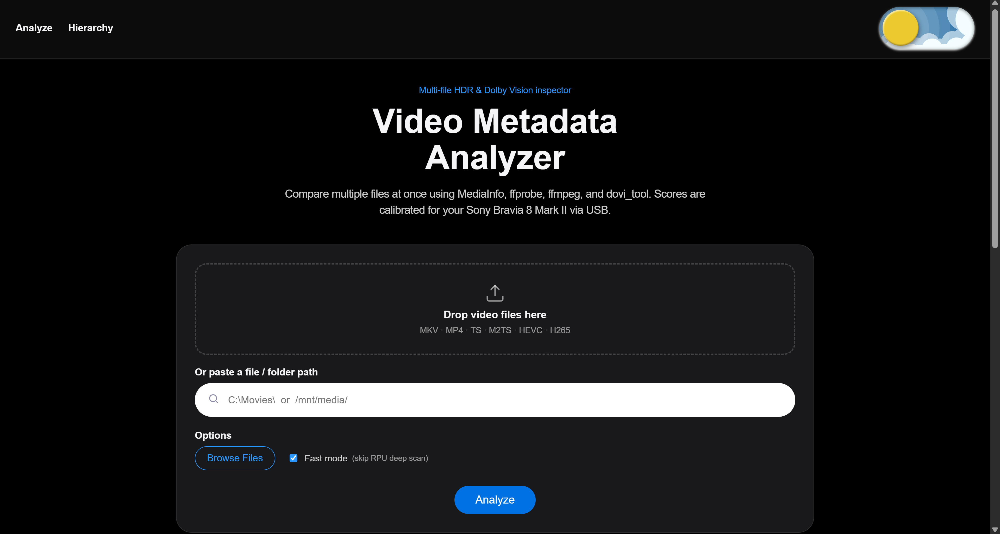
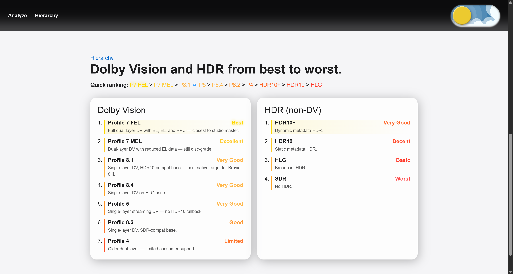

# Video Metadata Analyzer Dashboard

## Offline app launch and rollback

The primary packaged shortcut runs `<I>\python\pythonw.exe` with stable
`setup\launch_app.pyw`; `<I>` defaults to `D:\VideoComparatorPro`. It opens the
actual local app origin and authenticated relaunch returns to the same instance.
Private Python 3.11.9 venvs live at final `<I>\runtimes\<lock_sha256>\suite` and
`<I>\runtimes\<lock_sha256>\dashboard`; a proven unchanged legacy suite `.venv`
may be reused without modification. Code/assets live under
`<I>\app\releases\<build_id>` with hash-checked `release.json`, selected by atomic
`app\current.json` / `previous.json`. There is no runtime npm, package acquisition
or silent CPU/model replacement. The only supported Part 1 target is the current
Windows RTX 3050 Ti / CUDA 12.6 profile with VideoSuite 0.6.0 / `offline_payload`.
Later 0.7.0 unified features are not claimed by this release.

Source → test → artifact → installer → install: use existing dependencies to run
Dashboard backend tests, `npm test`, `npm run lint`, `npm run build`; run both
Comparizer gates with its mandated Python310 interpreter. Capture a fresh exact
Dashboard source snapshot and export with the explicit script arguments below.
Comparizer's `installer/build_installer.ps1 -DashboardArtifact ABS_ZIP -Acquisitions ABS_INVENTORY -BuildId BUILD`
checks that artifact and the sealed finite L1 inventory, then compiles with exact
installed Inno Setup 6.7.3. No build-time downloads; absent/unlisted inputs stop.
Production requires the owner-committed source pair and `-RequireCommitted` export;
`-Channel qa -QARoot ABS_OWNED_QA_ROOT -AllowDirty` explicitly selects QA.
Release rejects QA roots/dirty overrides, keeps the production AppId and uses
normal per-user temporary extraction plus the actual install-volume space check.
QA has a distinct AppId, visible QA ONLY name and separate shortcuts. It never
runs Python's registration-writing installer: preseed a verified QA-owned Python
3.11.9 copy and pass `/QAPythonDir=ABS_QA_PYTHON_COPY` to its EXE. A clean Python
installer step is not claimed by QA. Node.js 22.22.2 or a compatible supported newer version
is for source builds; the packaged app serves built dist without Node or Vite.
Only a separately authorized installed QA task may exercise clean/upgrade/rollback
with isolated synthetic media/private torrents. Real-TV validation is owner-only.

Quit before upgrade. Preserve dated copies of the entire protected owner suite
and app data plus the existing install before production refresh. Maintenance
refuses active app/Calibration writers, verifies a separate release, then switches
pointers and primary shortcuts. Failure restores the previous pointers, stable
launchers/tools and shortcuts. No rollback release/runtime/backup is deleted to
fit. C: keeps a 3 GiB margin; D: retains measured build/runtime/backup budgets.
The fresh owned QA scratch root selected explicitly at build time holds
only QA/extraction, with actual expansion + 24 GiB QA + 3 GiB margin. Never inspect
other E: folders/media; delete only that scratch root after later QA finishes.
App data and restricted IPC stay on NTFS (E: is exFAT).

For rollback, read the current Dashboard runtime and both build IDs from
`current.json` / `previous.json`, then use installed `tools\activate_app_release.py`:

```powershell
$savedDataRoot = $env:VIDEOLYZER_DATA_ROOT
$verificationRoot = Join-Path ([Environment]::GetFolderPath('LocalApplicationData')) ('VideoComparator-rollback-' + [guid]::NewGuid().ToString('N'))
$createdVerificationRoot = $false
try {
    New-Item -ItemType Directory -Path $verificationRoot -ErrorAction Stop | Out-Null
    $createdVerificationRoot = $true
    $env:VIDEOLYZER_DATA_ROOT = $verificationRoot
    & 'D:\VideoComparatorPro\runtimes\CURRENT_DASHBOARD_LOCK\dashboard\Scripts\python.exe' 'D:\VideoComparatorPro\tools\activate_app_release.py' --install-root 'D:\VideoComparatorPro' --release-id PREVIOUS_BUILD --expected-previous CURRENT_BUILD
    if ($LASTEXITCODE -ne 0) { throw 'Rollback verification failed; current release retained' }
} finally {
    $env:VIDEOLYZER_DATA_ROOT = $savedDataRoot
    if ($createdVerificationRoot -and (Test-Path -LiteralPath $verificationRoot)) { Remove-Item -LiteralPath $verificationRoot -Recurse -Force }
}
```

The fresh verification directory must be on per-user NTFS storage. Standalone
activation also creates and cleans owned temporary state when no override exists.

Replace placeholders with verified pointer values; do not edit the pointers or
move a venv. Activation validates the target and rejects a stale expected-current
build. Installer early failures go to `<I>\install-bootstrap-*.log`, later runtime
details to `<I>\install_log.txt`; **Open log** opens only the app's backend log.
Uninstall preserves settings, calibration, observations, uploads and reports.
Migration installs retain hidden root CLI/Tk launchers as manual fallbacks; for
a clean install use the selected suite runtime from its release suite directory,
with manifest tool directories on PATH. See Comparizer's VIDEOSUITE.md for details.
The legacy source/developer setup below can download dependencies and is never
the packaged upgrade/repair path.

## Offline Dashboard artifact and first run

Part 1 uses VideoSuite **0.6.0** with `offline_payload`. Build with the existing
node_modules, then export from this checkout using `scripts/build-app-payload.ps1`
with explicit `-Destination`, `-BuildId`, full `-Revision` and a fresh
`-SnapshotManifest`. `-RequireCommitted` refuses dirty production artifacts.
The named `dashboard-<build_id>.zip`, `.manifest.json` and `.sha256` contain the
flat backend allowlist, built dist and exact runtime/npm locks. Source snapshots
must match every current source file. Uploads, movies, reports, environments and
node_modules are excluded. The exporter never reads a sibling checkout.

Packaged `/app/status` checks both private Python 3.11.9 runtimes, their pinned
package closure, suite capabilities, required model hashes/CUDA, explicit packaged
tools (including ffmpeg libvmaf and the MediaInfo CLI), cp311 libtorrent and
writable app scratch/report space. There are no first-run downloads. Missing or
corrupt required models, unavailable required CUDA, or any other failed required Full-engine check
refuse Full before its pixel worker starts; repair with the matching offline
installer. Quick/metadata paths remain available within their own tool requirements.
Missing optional tooling reports its own capability.
The magnet-only current-PC prerequisite message is:
“Magnet links are unavailable on this PC (OpenSSL 1.1 files not found); file comparison still works”.
The existing System32 OpenSSL files are never bundled or installed. Their check
runs in a disposable private cp311 process with restricted DLL search, approved
app-local VC DLLs, private Python DLLs, and explicit packaged libtorrent; developer
imports cannot satisfy release verification. Missing cp311 libtorrent blocks release.

## Packaged app controls and reconnect

You can close this tab. Reopen the shortcut to return. Use Quit to stop the app.
Closing or unloading the browser never cancels a job or starts an idle shutdown
timer. The packaged UI lists all active analysis, magnet, suite and calibration
jobs from `GET /app/status` and reconnects their `/job/{job_id}` progress. Finished,
failed, cancelled and missing jobs stop polling. Results are in memory for this
app launch; there is no permanent history database.

`POST /app/bootstrap {}` retains L3's exact Origin, JSON and same-origin Fetch
Metadata checks. `POST /app/quit {"mode":"keep"|"when_finished"|"stop"}` and
`POST /app/open-log {}` additionally require `X-VideoSuite-Token`. The random
per-launch token stays in browser memory only, never a URL, storage or log.
Missing/wrong token or Origin returns 403; non-JSON controls return 415. These
controls require the packaged launcher; source development keeps its explicit
two-server setup without privileged app controls.

**Keep running** withdraws a pending when-finished Quit. **Quit when finished**
blocks new work and waits for every job kind and registered worker.
**Stop jobs and quit** requests cancellation immediately, waits up to 10 seconds, forces
remaining owned child trees and waits up to 5 seconds. Uvicorn's graceful
shutdown is bounded to 3 seconds. The response is sent before server shutdown.
Stop cannot be withdrawn once cancellation begins. A surviving owned worker
keeps the app and instance evidence alive, with an error in app status; the UI
never claims successful Quit merely because cancellation was accepted. Python
threads cannot be forcibly killed safely; a stuck native thread therefore
produces this error instead of successful Quit. Job Object assignment failure
retains the documented best-effort crash cleanup limitation.

`app_lifecycle.py` owns admission/cancellation and `app_routes.py` owns guarded
controls; both ship in `app-payload.json` with transitive-import closure tests.
Tool children retain hidden Windows flags. Open log opens only the backend's
fixed `logs/backend.log` under the explicit `VIDEOLYZER_DATA_ROOT` (default app
data root); it accepts no user path. Existing launcher logs remain alongside it.
No app control owns or closes the external browser.

[](https://react.dev)
[](https://fastapi.tiangolo.com)
[](https://vitejs.dev)
[](https://eslint.org)
[](LICENSE)

A full-stack video analysis app that compares local movie files using MediaInfo, ffprobe, ffmpeg, and dovi_tool, then ranks playback quality for Sony Bravia 8 Mark II USB playback.

## What This Project Does

- Analyzes one or many video files (.mkv, .mp4, .m4v, .ts, .m2ts, .hevc, .h265).
- Detects Dolby Vision profile details (including Profile 7 / 8 variants where possible).
- Computes quality, TV score, confidence score, and audio score.
- Shows rich comparison visuals: leaderboard, radar chart, score bars, and bitrate chart.
- Provides per-file USB compatibility hints for Bravia 8 Mark II.
- Supports background jobs with progress streaming (SSE) for long-running scans.
- Runs the installed VideoSuite (device playback scoring, quality ranking, pixel comparison) through the `/suite/...` endpoints (see `docs/SUITE_INTEGRATION.md`).

## Legacy scoring (frozen)

`tv_score`, `score`, `confidence_score`, `tv_support`, `composite_score` and the
magnet-compare winner come from the Dashboard's own Bravia model. This model was
frozen on 2026-10-11 with HDR10 26 / HLG 22 / SDR 10; it is no longer tuned and
will be retired in Plan 3. The device-aware answer is the `suite` block on every
magnet analysis and the `/suite/...` routes, described in `docs/SUITE_INTEGRATION.md`.

## Tech Stack

- Frontend: React 19 + TypeScript + Vite
- Backend: FastAPI (Python)
- Metadata/tooling: MediaInfo, ffprobe/ffmpeg, dovi_tool
- Optional: the installed VideoSuite (`python -m videosuite`), called as a subprocess, never imported

## Project Structure

```text
videolyzer-dashboard/
  src/                 # React UI
  scripts/             # Helper scripts for polling/SSE testing
  uploads/             # Temporary upload storage (auto-used by backend)
  docs/                # ARCHITECTURE.md, TESTING.md, SUITE_INTEGRATION.md
  tests/               # pytest suite (fakes by default; opt-in live suite tests)
  main.py              # FastAPI app, upload/path/magnet routes, job runners
  analysis.py          # Core metadata extraction + scoring logic
  jobs.py              # In-memory job store (locked, deep-copy reads, cancel flags)
  request_guard.py     # Host/Origin/Fetch-Metadata/Content-Type guard (ASGI middleware)
  path_guard.py        # Validation of every server-local path
  suite_client.py      # Subprocess client for the VideoSuite CLI (validates videosuite-<cmd>/1 JSON)
  suite_routes.py      # /suite/version, /suite/devices, /suite/settings, /suite/score, /suite/rank, /suite/compare
  calibration_routes.py # /suite/calibration/plan, status, session, record, build, apply, undo, report
  suite_version.py     # Version handshake, capability gates and cached startup check
  magnet_suite.py      # Bounded, nonfatal scoring of retained partial magnet files
  proc_guard.py        # Windows kill-on-close Job Object for suite children
  magnet.py            # libtorrent head/tail download, torrent session settings, port pool
```

## Screenshots

### Landing / Analyze Screen


### DV / HDR Ranking Page


## Prerequisites

Install these before running:

- Node.js 22.22.2 or newer (22.x), 24.15+ or 26+ (the test tools need it; running and building alone work from 20.19+ or 22.12+)
- Python 3.11+
- FFmpeg (must include ffmpeg + ffprobe on PATH)
- MediaInfo CLI (mediainfo on PATH)
- dovi_tool (optional but recommended for deeper DV parsing)

## Quick Start

This section is legacy source development, with an explicitly separate backend
and Vite origin. It can download dependencies; use the offline app section above
for packaged launch, upgrade and repair.

### One-command local startup (recommended on Windows)

```bash
npm run dev:stack
```

This launches backend and frontend in two dedicated PowerShell windows. The backend
starts without `--reload` for real use. You can also run `scripts\start-local.ps1`
directly; add `-Dev` only for development reloads, which interrupt running jobs.
`-Python` selects the interpreter (default `python` from PATH, including libtorrent).

### 1) Install frontend dependencies

```bash
npm install
```

If you see an import error for axios, install it once:

```bash
npm install axios
```

### 2) Install backend Python dependencies

Create a virtual environment once, then install the pinned requirements:

```powershell
python -m venv .venv
.\.venv\Scripts\Activate.ps1          # macOS/Linux: source .venv/bin/activate
python -m pip install -r requirements.txt
```

`uvicorn[standard]` is optional (adds faster extras such as `watchfiles` for `--reload`); plain `uvicorn` is pinned in `requirements.txt`. To run the tests install `requirements-dev.txt` instead (see `docs/TESTING.md`).

For the magnet-link feature you also need libtorrent:

```bash
python -m pip install libtorrent
# macOS may also need: brew install libtorrent-rasterbar
# Debian/Ubuntu may use: sudo apt install python3-libtorrent
```

The rest of the app boots fine without it — only the `/magnet/` endpoint will return an error explaining how to install it.

Optional (for helper scripts):

```bash
python -m pip install requests
```

### 3) Start the backend (FastAPI)

```bash
python -m uvicorn main:app --host 127.0.0.1 --port 8000
```

### 4) Start the frontend (Vite)

```bash
npm run dev
```

For two-server source development, set `VITE_API_BASE` to the explicit backend origin
(for example `http://127.0.0.1:8000`) before `npm run dev`. Only http(s) origins on
localhost, 127.0.0.1 or [::1] are accepted; paths, credentials and remote hosts are refused.
Open the app at the URL printed by Vite (usually http://127.0.0.1:5173 or http://localhost:5173).

Built production JavaScript always uses relative API, cancellation and SSE URLs;
`VITE_API_BASE` is ignored in production. `npm run build` emits `dist` and a Vite
asset manifest. The packaged Python host serves that build without runtime Node.
It calls `configure_origin(app, actual_origin)` before ASGI startup, using the origin
of its already-bound socket, then `install_static(app, dist)`. `main:app` is the
two-server source-development entry and enables loopback development CORS.
Static navigation is allowlisted: `/`, `/analyze`, `/suite`, `/calibration`.
`/assets/{asset_path:path}` serves built assets and `/favicon.svg` serves the app icon;
missing assets return 404.
Unknown routes and reserved API prefixes never fall back to HTML.

Packaged Windows startup uses the stable `<install>\setup\launch_app.pyw`
shortcut under the install's private Pythonw. The supervisor resolves
`app/current.json` from that file's installation, checks its `manifest_sha256`
against `app/releases/<build_id>/release.json`, verifies the release inventory
and selects the manifest's private suite and Dashboard runtimes. A pointer uses
schema `videosuite-app-pointer/1`, `install_id`, `build_id`, `release`,
`manifest_sha256` and `runtimes: {suite, dashboard}` (forward-slash paths relative
to the install). Runtime references must match the manifest exactly. Traversal,
reparse points, missing pointers and mismatched builds fail with a native dialog
and a launcher log; legacy CLI/Tk entry points remain available.

The launcher invokes the release's `app_host.py --ready-handle <inherited-handle>`
using its private `Scripts\pythonw.exe`, an argument array and hidden Windows
creation flags. This is an internal entry: the inherited duplex handle carries
JSON release configuration and a fresh launch secret. The secret is never an
argument, environment variable, URL, browser storage item or log entry.
`serve(install_root, release, ready_pipe)` and `bind_loopback(preferred_port=8000)`
are the hosting interfaces. The backend exclusively binds `127.0.0.1:8000`, or
binds port `0` if occupied, and passes that same socket to uvicorn. Startup and
suite-check status precede private readiness; no HTTP health probe can authorize
opening a browser. The browser receives only the actual bound origin.

A per-user SID mutex keeps the first launcher alive until backend exit. A
user-only ACL protects its instance record and local named pipe. Second launches,
including another installation, authenticate a fresh JSON activation exchange,
build/install/session identities and PID creation time, then reopen the active
app and identify its install/build. Stale or locked unverified state fails closed;
unrelated listeners and processes are never adopted or terminated. Closing a
browser has no lifecycle effect. The backend inherits a kill-on-close Job Object
after assignment and before bootstrap; assignment failure is logged explicitly
as best-effort crash cleanup. Coordinated user Quit is handled by app lifecycle.

`GET /app/status` exposes public identity, startup checks and active jobs without
credentials. `POST /app/bootstrap {}` requires the exact production Origin,
`application/json`, `Sec-Fetch-Site: same-origin`, mode `cors` or `same-origin`,
and destination `empty`; it returns an in-memory token with `Cache-Control:
no-store`. Missing/foreign/null origins fail. Privileged app controls use this
token in `X-VideoSuite-Token`, never in URLs. Same-user native programs are not
an authentication boundary.

`VIDEOLYZER_DATA_ROOT` selects the app data root (default
`%LOCALAPPDATA%\VideoComparator\app`); uploads are created under its `uploads`
child at startup, with no filesystem writes on import. Tests must override it.
The launcher also uses its `instance` and `logs` children. Packaged startup sets
absolute `VIDEOSUITE_PYTHON` and `VIDEOSUITE_ROOT` from the selected release,
`VIDEOSUITE_OFFLINE=1`, packaged `TORCH_HOME`, `HF_HOME`, `CLIP_CACHE_DIR`,
`HF_HUB_OFFLINE=1`, `TRANSFORMERS_OFFLINE=1`, `PIP_NO_INDEX=1` and
`PIP_DISABLE_PIP_VERSION_CHECK=1`. There is no runtime provisioning or download.
`LOCALAPPDATA` supplies the per-user Windows default. Raw media paths are displayed
as text rather than local-file links.

If you need custom ports, run the script directly:

```powershell
powershell -ExecutionPolicy Bypass -File .\scripts\start-local.ps1 -BindHost 127.0.0.1 -ApiPort 8000 -WebPort 5173
```

## How To Use

1. Drag and drop video files, browse for files, paste a server-local file/folder path, or paste a magnet link.
2. Toggle Fast mode if you want quicker scans (skips deep RPU scan path).
3. Click Analyze (or Analyze Magnet).
4. Review ranked results, DV profile details, confidence, and USB compatibility guidance.

### Magnet links

Paste a `magnet:?` URI into the magnet input. The backend will:

1. Fetch the torrent's metadata (file list) — no actual files downloaded yet.
2. Classify each entry: video files vs. junk (`.rar`, `.exe`, `sample`, etc.).
3. Download only slices of each video file: the first 32 MiB of every video, plus the last 64 MiB of `.mp4` and `.m2ts` files (the `moov` atom can sit at the end). Files larger than 15 GiB also get roughly one extra piece every 10 GiB so the HDR10+ scan can look inside the stream; on Windows this interior sampling happens only when the request carries `?hdr10plus=true`. Whole pieces are fetched, so the real amount is slightly larger.
4. Run the standard analysis on each partial file and mark which ones are good or bad to play.
5. Pause the torrent, attach device-aware VideoSuite partial scores to each analysis,
   then delete the partial download and tear down the torrent session.

Every magnet analysis carries a `suite` block: `ok` includes `tool_version`,
`partial`, `record` and `best_player`; `unavailable` explains a missing suite or
missing `score_partial` capability; `error` includes `error_kind` and `message`;
`skipped` explains cancellation, the file limit or the exhausted budget. Suite
failure is nonfatal to the magnet job. At most 8 files are scored sequentially
per torrent, within a 300 s budget counted from the start of the suite stage,
before client creation and the version check. The torrent is paused throughout
that stage. A last score can take 105 s; termination, wait, reader joins and pipe
cleanup share one collective 5 s deadline. Worst case: 300 + 105 + 5 = 410 s,
below the 420 s stage ceiling.

The backend never downloads a large file in full and never seeds on purpose: the session lives only for the job and is removed afterwards, but while it runs it may upload the pieces it holds to other peers (capped at 50 KiB/s, see below). The temp directory is removed regardless of success or failure.

### Torrent session hardening

- UPnP, NAT-PMP and local service discovery are switched off; DHT stays on. Upload is capped at 50 KiB/s (`upload_rate_limit = 51200`), never lower: a ~1 B/s limit makes peers choke us (tit-for-tat) and downloads stall. Unchoke slots stay at the libtorrent default.
- Every torrent session gets its own listen port from one process-wide pool (`magnet.PortAllocator`, ports 6881-6999). `/magnet/` and every slot of `/compare-magnets/` take a port and always give it back, so concurrent jobs never share a port. If the pool is exhausted the job ends `error` with `error_kind: "busy"`.
- MP4/M2TS files no larger than 96 MiB (head 32 MiB + tail 64 MiB) are treated as fully downloaded instead of being reported as "tail missing".
- `files[]` entries now carry `size_gib` (size in GiB, 1024^3). `size_gb` is a DEPRECATED alias with the same GiB number (not decimal GB); the UI still reads it until Plan 3.
- Testing note: libtorrent is not installed on the development machine, so these changes are tested with fakes only (pure helpers `session_settings`, `PortAllocator`, `tail_is_present`, `file_record`, plus a fake `libtorrent` module). The owner must run ONE real magnet after this change (single `/magnet/`, ideally followed by a 3-magnet `/compare-magnets/`) to confirm metadata and pieces still arrive. If magnets stall, remove `upload_rate_limit` from `magnet.session_settings` first (it is the only new behavioural key).
- Live check (needs libtorrent; run it in the Python that has it): every key of `session_settings` must be a real libtorrent setting, otherwise `lt.session(...)` raises.

  ```python
  import libtorrent as lt
  from magnet import session_settings
  assert set(session_settings(6881)) <= set(lt.default_settings())
  ```

## Suite tab

Open **Suite (all devices)** next to **Analyze** for device playback checks and picture comparison. The core Suite routes require VideoSuite 0.3.0 or later; install 0.4.0 for owner settings, partial-file scoring and current progress features. The banner explains readiness; use **Check again** after installing or changing settings.

Type or paste one full local video path per line, 1 to 50 files. Explorer **Copy as path** quotes are accepted. A list with any invalid line is not sent, including its valid subset. Choose a device/player, USB file system (**Owner settings (per device)** by default), and audio/subtitle language.

**Score files** shows a card per device with verdict, evidence word, score (a range when uncertain), what you will see, issues in veto/warn/risk/info order, and the best player. Forum, inferred and unknown evidence show a visible **Unverified rules** note; confirm those rules with your own playback test.

Evidence (weakest rule used): official = the maker's documentation; owner = tested by you; reviewed = a professional review; forum = user reports; inferred = our deduction; unknown = no information. A score range (for example 69-99) means the result is uncertain.

**Compare and rank** runs `compare` then `rank` automatically, using Fast or Accurate mode, top K 1-6 and a reports folder without `& ^ % ! " ' < > |`. It shows only VideoSuite's own estimate and per-pair progress. Cancel waits for the backend to confirm the job stopped. Retained progress lines may be incomplete; the pair counter is a lower bound, and saturated logs hide stale progress percentages.

Owner settings are read-only (`/suite/settings`). The latest completed run's settings block is labelled separately from device facts from the last settings check; **Check again** may reuse a cached document for up to 60 seconds. Magnet results, including every expanded series episode's releases, show their own VideoSuite block. The **Analyze** view is the legacy Bravia-only view; its reference TV/USB and HDR hierarchy panels start collapsed. Switching tabs preserves typed inputs and running jobs.

## Calibration (TV)

The third tab, **Calibration (TV)**, checks playback on your Sony Bravia 8 II. It requires the `calibration` capability from VideoSuite 0.5.0. With an installed 0.3/0.4 suite it says "Please update VideoSuite to 0.5.0 to use calibration." The Suite tab keeps working; the Calibration tab sends no calibration requests until the capability is available.

1. **Plan kit** previews tests and the estimated total size; **Prepare kit** is enabled after a plan for the current paths and scan options is shown, and builds the test files and `kit.json`. Paste up to 50 source video paths, or leave them empty for tests that need no source. Use a separate local output folder without `&` or `%`. Build and session refuse an output folder that is, or lies inside, a link or junction; VideoSuite also checks separation from source/repository folders and refuses to replace existing kit files. A deep Dolby Vision scan verifies FEL/MEL for that run.
2. **Confirm conditions** after checking the TV software, audio output and USB file system. Audio/USB values come from owner settings; change them there and use **Check settings again**. The TV-software input is single-line and limited to 100 characters. Answers keep their recorded conditions; older TV software needs fresh answers, and unknown or different required conditions cannot become applied evidence.
3. Tick results by selecting a test in the **checklist table** and answering in the **guided card**. Both show the frozen prediction and evidence word. The card provides playback instructions, observed-outcome buttons, **Not sure**, **Skip**, Back/Next and a single-line optional note limited to 500 characters. Saved outcomes, match status and progress come from the store.
4. **Preview changes**, inspect each action/reason, then **Apply** the displayed revision. Silent/unsupported vetoes each need a checkbox and a separate confirmation button; unconfirmed vetoes are skipped. Unsure, informational, skipped and conflicting answers do not become owner evidence. Changed answers/settings invalidate the preview; a refused apply refreshes it for review. **Undo this kit** leaves later changed entries alone and reports them.
5. **What changed** accepts local video paths and shows before/after playback verdict, score, evidence, audio, HDR and best-player changes. It is read-only, playback only, not a quality ranking. An undone or replaced kit is labelled inactive and gets no later-change attribution.

If settings change during apply, HTTP 409 `settings_changed` says: "The settings file changed while applying. Preview and apply again." Review the refreshed preview before retrying. Undo remains available with a loaded kit even when conditions differ or owner settings have errors; it waits for ongoing checks and operations.

VideoSuite writes sessions, answers and apply/undo transactions to `calibration.json`; apply/undo update scoped `rule_overrides` entries in `settings.json`, preserving other settings semantically. Writers use the OS-managed `calibration.lock` beside settings and back up existing settings bytes to `settings.json.bak`. Preview, status and report are read-only. Kit files are written only in the selected output folder; see the route and safety contract in [Suite integration](docs/SUITE_INTEGRATION.md).

The tab stays mounted after its first visit. The remembered kit id is saved in browser storage and saved answers reload from VideoSuite. Reloading after a build but before its first session loses the browser's pending descriptor: start that session from the CLI with `calibrate session --kit-file <out>\kit.json` or rebuild. Confirm conditions before reloading a newly built kit.

## API Endpoints

Every route passes the request guard; every route that takes a server-local path also passes the path guard (see Security model). Routes exposed by the backend:

- GET /health/ - service health + disk usage
- POST /analysis/ - analyze one multipart file (returns `{job_id, total}`)
- POST /analyze-multiple/ - submit multi-file batch job (returns `{job_id, total}`)
- GET /analyze-path/ - analyze a server-local file or folder as a background job (returns `{job_id}`)
- GET /job/{job_id} - poll job status/results (404 `{"detail": "Job not found."}` for an unknown id)
- GET /job/{job_id}/events - SSE stream of job events; ends with `data: __done__` when the job is `done`, `error` or `cancelled`. (There is no `/progress/{job_id}` route; older notes mention it, it never existed in this backend.)
- GET /scan-folder/ - synchronous folder scan (404 when the folder has no video file that passes the path guard)
- POST /magnet/ - submit a magnet link (JSON `{"magnet": "magnet:?..."}`); fetches metadata + head/tail slices, classifies each file, and runs ffprobe on the partial data (cleans up afterward). Optional query flags `fast` and `hdr10plus`.
- POST /compare-magnets/ - compare 1 to 8 magnets (JSON `{"magnets": ["magnet:?...", ...]}`, query `fast` (default true) and `hdr10plus`); returns `{job_id, total}`. The finished job carries `per_magnet`, `comparison`, `winner`, `mode` (`movie` or `series`), `episode_comparison` and `dropped` (magnets that produced no analysable file). Up to 2 magnets run one after the other; 3 to 8 run with at most 2 parallel sessions.
- POST /magnet/{job_id}/cancel - cancel an in-flight magnet job
- POST /compare-magnets/{job_id}/cancel - cancel an in-flight magnet comparison
- POST /job/{job_id}/cancel - cancel any job (see Job states below)
- GET /suite/devices - the VideoSuite device catalogue (cached 60 s); needs videosuite 0.3.0 or later
- GET /suite/settings - the owner settings VideoSuite reports (read-only: settings file path, loaded or not, errors, applied overrides, per-device USB file system and audio output); shares the 60 s devices cache
- POST /suite/score - device playback scoring of 1 to 50 video files (job)
- POST /suite/rank - quality + playback ranking of 1 to 50 video files using an existing folder of Comparizer reports (job)
- POST /suite/compare - pixel comparison of 1 to 50 video files into an output folder (job, one at a time)

- POST /suite/calibration/plan - plan a calibration kit for the owner's TV (needs videosuite 0.5.0): answers the plan document at once, or `{job_id}` (a cancellable job) when `deep_dv` is true; a source file may be missing (its folder must exist): it is skipped and its excerpt tests are reported `needs_real_file`
- GET /suite/calibration/status - the calibration store's view of the latest (or `?kit=`) kit: descriptors, session, answers, `recovery_required`
- POST /suite/calibration/session - record the conditions the owner confirmed (TV software, audio output, USB file system) for the kit folder `out` (refused when `out` is or sits inside a link or junction)
- POST /suite/calibration/record - record one answer (`kit`, `test`, `player`, `outcome`, `note`)
- POST /suite/calibration/build - build the kit's test files into an output folder (job, heavy: one at a time with a comparison or a deep-DV score; `out` may not be or sit inside a link or junction)
- POST /suite/calibration/apply - preview (`preview: true`) or apply (`revision` from the preview, `confirm_veto` ids) the recorded answers as owner settings
- POST /suite/calibration/undo - undo a kit's applied settings
- POST /suite/calibration/report - playback-only before/after report of files for a kit (job; not a quality ranking)

The fourteen `/suite/...` routes are described in `docs/SUITE_INTEGRATION.md` (request bodies, response documents, error kinds, exit codes). A `/suite` job POST answers 503 `{"detail": "VideoSuite is not installed (set VIDEOSUITE_PYTHON and VIDEOSUITE_ROOT)"}` and creates no job when the suite is not installed.

Heavy jobs are `suite_compare` and `suite_score` with `deep_dv: true`: only one
runs at a time. A second comparison gets 409 `a comparison is already running`.
Other heavy-job conflicts get 409 `a comparison is already running; only one heavy job (a picture comparison or a deep Dolby Vision scan) runs at a time`
or `a deep Dolby Vision scan is already running; only one heavy job (a picture comparison or a deep Dolby Vision scan) runs at a time`, naming the active job.
A calibration kit build and a deep-DV calibration plan (`suite_calibration_build`, `suite_calibration_plan`) are heavy too:
one heavy job at a time in total, 409 both ways (`a calibration kit job is already running`, or the
running job named followed by `; only one heavy job (a picture comparison, a deep Dolby Vision scan or a calibration kit job) runs at a time`).
At most two score/rank jobs run together; exceeding that gets 409
`too many suite jobs are running` (this capacity check takes precedence; calibration build/plan take no
score/rank capacity, a calibration report takes one).
Magnet jobs are not heavy: their short, sequential partial scores can run beside a heavy job.

Compare timeout uses a valid positive `VIDEOSUITE_COMPARE_TIMEOUT_S` exactly.
Otherwise it is `max(21600, pairs * per_pair_budget + 600)` seconds,
where `n = min(len(paths), 2 * top)`, `pairs = n * (n - 1) / 2`, and the per-pair
budget is 1800 s for `fast` or 9000 s for `accurate`.

On Windows, each real suite child is attached immediately after launch to a
kill-on-close Job Object. Closing or crashing the backend kills its attached
children; this is the primary guarantee. Shutdown cleanup is the fallback:
`scripts/start-local.ps1` starts uvicorn with `--timeout-graceful-shutdown 3`,
so one Ctrl+C runs the shutdown cleanup (which kills registered process trees)
after at most 3 seconds, even while a suite job is running. A second Ctrl+C
is not needed and can skip the cleanup. Job Object failures (including nested
jobs) are logged and leave only that shutdown cleanup, so crash protection is
best effort on those systems. If you start uvicorn yourself, pass the same flag. Cancel/timeout kills the process tree.
Under thread exhaustion, injected cleanup killers must return promptly; Python
cannot preempt them inline. If termination fails and no cleanup thread can start,
an active daemon reader's pipe can remain pending EOF/garbage collection.

## Job states

`GET /job/{job_id}` returns `status` `running`, `done`, `error` or `cancelled` (the last three are terminal), plus the extra keys `kind` and `error_kind`. Suite jobs add `error_detail` when the CLI wrote to stderr and `exit_code` when the CLI got as far as exiting.

- `kind`: `single`, `batch`, `path`, `magnet`, `compare`, `suite_score`, `suite_rank`, `suite_compare`, `suite_calibration_plan`, `suite_calibration_build`, `suite_calibration_report`.
- `error_kind` (set only while `status` is `error`, otherwise `null`):
  - Upload, path and magnet jobs: `timeout` (analysis timed out or returned nothing, or the magnet job timed out), `analysis_failed` (every file failed or the analyser raised), `no_files` (no video file in the folder), `unavailable` (libtorrent is not installed), `busy` (all 119 torrent ports, 6881-6999, are in use), `no_analyses` (a magnet comparison produced nothing comparable), `internal` (anything unexpected; the text in `error` is the exception message for magnet, magnet-comparison and folder jobs).
  - Suite jobs: the CLI client kinds `usage` (exit 2 or a rejected value), `no_files` (exit 3), `ffprobe_missing` (exit 4), `failed_pairs` (compare exit 1, results kept), `contract` (malformed, unversioned or oversized CLI JSON), `timeout`, `failed` (any other exit code), `unavailable` (process could not be started), plus `busy` (the concurrency slot was taken when the runner started) and `internal` (unexpected exception; the message is a fixed string, no exception text).
- `error_detail` (suite jobs only, additive): the last 500 characters of the CLI's stderr. It is only present when there was stderr text; HTTP error responses of the `/suite` routes never carry it.
- `exit_code` (suite jobs only, additive): the CLI's exit code when it is known: that of the failed call (`usage` 2, `no_files` 3, `ffprobe_missing` 4, `failed`, `timeout` and `contract` when the process had exited), or 1 for `failed_pairs`. It is absent when the CLI never ran to an exit (`unavailable`, `busy`, `internal`, `cancelled`).

- A job whose analysis timed out or returned nothing (`analysis timed out or failed`), whose folder holds no video files (`no video files found`) or in which every file failed ends `error` with the reason in `error`. These used to end `done` with empty results.
- The cancel routes return `{"ok": true}` for any existing job (even a finished one, which stays as it is) and 404 `{"detail": "Job not found."}` otherwise. A cancelled job stops queuing new files, finishes the analyses already running, and ends `cancelled` with `error: "cancelled"` and its partial `results`/`per_magnet`. Suite jobs (`suite_score`, `suite_rank`, `suite_compare`): cancelling a running job kills the whole CLI process tree at once and the job ends `cancelled` (no results); a suite job cancelled while it is still queued never starts the CLI and ends `cancelled` as well.
- `/job/{job_id}/events` (SSE) ends with `__done__` on `done`, `error` or `cancelled`.
- Finished jobs are kept in memory (the newest 20, never purged within 30 s of finishing); the purge happens when a new job is created.

## Security model

The backend is a local tool: it binds to loopback (`--host 127.0.0.1`), has no login, and can read any video file the user's account can read. Three layers keep a web page or a stray path from abusing that:

1. **Request guard** (`request_guard.py`, below): only requests that look like they come from the local UI or a local script get through; a web page on another site cannot start a job, read a path or start a torrent, and DNS-rebinding hosts are refused.
2. **Path guard** (`path_guard.py`, below): every server-local path (the `path` of `GET /analyze-path/` and `GET /scan-folder/`, and every `paths`, `reports_dir` and `out_dir` of the `/suite` routes) is checked before any job exists. UNC and device paths, relative paths, alternate data streams and non-video files are refused.
3. **Allowed roots** (`VIDEOLYZER_ALLOWED_ROOTS`): an optional list of folders. When set, a path must resolve (junctions and symlinks followed) to somewhere inside one of them, otherwise 403. Default: empty, which allows any local drive.

The **remote-drive rule**: a path typed with a mapped network drive letter (`Z:\videos\a.mkv`, drive type "remote") is refused with 400 `network drives are not allowed` unless `VIDEOLYZER_ALLOW_REMOTE_DRIVES` is exactly `1`. Windows resolves such a path to a UNC path (`\\server\share\...`), so the guard looks at the drive letter you TYPED: a resolved UNC path is accepted only when that letter is a network drive, the variable is `1` and the result is not a device path. A path you type as UNC (`\\host\share`, `//host/share`, `\\?\UNC\...`) and a `\\.\` device path are refused always, whatever the variable says, and so is a junction or symlink on a local drive that points at a share. This rule has been tested with a faked drive type and a faked resolver only, not against a real mapped drive: if a real mapped drive is still refused with the variable set, keep the variable unset and use a local copy.

Subprocesses never see a shell: the suite client starts `python -m videosuite` with an argument list (never a `.bat`), passes file paths in a UTF-8 list file, and rejects shell metacharacters in the two folder values.

Residual risk (stated, not hidden):

- Browsers older than Fetch Metadata (Safari < 16.4) send neither `Origin` nor `Sec-Fetch-Site` on a no-cors GET, so the job-starting GET routes (`/analyze-path/`, `/scan-folder/`) are not protected against a hostile page in such a browser. Plan 3 moves those job-starting GETs to POST.
- The guard is not authentication: any program running on the same machine (no `Origin`, no `Sec-Fetch-Site`) is treated like curl and passes.
- With no allowed roots configured, any local drive is readable, and a junction or symlink inside an allowed local folder may lead to another local folder (network shares stay refused, mapped drives only with `VIDEOLYZER_ALLOW_REMOTE_DRIVES=1`, and then a mapped drive may resolve to any network host). Set `VIDEOLYZER_ALLOWED_ROOTS` to close that, and always set it when remote drives are enabled.
- A path is validated when the request arrives and used when the job runs. A single file whose junction or symlink is swapped in between is not re-checked (folder scans do re-check every file they walk).

## Request guard (security)

The backend listens on loopback but starts jobs, reads local paths and starts torrents on plain requests, so every request passes `request_guard.py` first:

- In the packaged host, `Host` must exactly match the actual bound `127.0.0.1:port`,
  otherwise 400; a supplied `Origin` must exactly match its http origin, otherwise 403.
  Production CORS permits only that exact origin, including preflight requests.
  The following broader rules apply only to the `main:app` source-development entry.
- Development `Host` must be `localhost`, `127.0.0.1` or `[::1]` (optional port), otherwise 400 (blocks DNS rebinding).
- `Origin`, when sent, must be an http(s) loopback origin, otherwise 403 (includes `Origin: null`). An allowed Origin is trusted even when the browser labels the request `cross-site` (the UI on `localhost:5173` calling `127.0.0.1:8000`).
- With no `Origin`, a request carrying `Sec-Fetch-Site: cross-site` or `same-site` is refused with 403 (blocks ``/link/no-cors GET and cross-site navigations). `same-origin`, `none` and requests with neither header (curl, scripts, tests) pass.
- `POST /magnet/`, `POST /compare-magnets/` and every `POST /suite/...` must be `application/json` (415 otherwise). The cancel routes and the multipart upload routes are not affected.

Browsers answer CORS preflights first; the guard's refusals for an allowed origin still carry CORS headers.

Residual risk: browsers older than Fetch Metadata (Safari < 16.4) send neither `Origin` nor `Sec-Fetch-Site` on a no-cors GET, so the job-starting GET routes (`/analyze-path/`, `/scan-folder/`) are not protected against a hostile page in such a browser. Plan 3 moves those job-starting GETs to POST.

## Path guard (security)

`GET /analyze-path/` and `GET /scan-folder/` read server-local paths, so every path passes `path_guard.py` first; so do the `paths` (video FILES only, no folders), `reports_dir` (an existing folder) and `out_dir` (a folder that need not exist but whose parent must) of the `/suite` POST routes. Rejections never echo exception text or any path other than the one you sent.

- 400: empty path, NUL character, UNC (`\\host\share`, `//host/share`), `\\?\` and `\\.\` device paths, relative or drive-relative paths (`C:foo`, `\Windows`), device names (`NUL`, `CON`), alternate data streams (`file::$DATA`), a path that cannot be resolved or accessed, a file where a folder is required (and the reverse), paths on a network drive (see the remote-drive rule above), and files that are not video files. Supported extensions: `.mkv .mp4 .m4v .ts .m2ts .hevc .h265` (so `win.ini` is refused rather than handed to mediainfo). A plain long-path prefix `\\?\C:\...` is stripped and the path is then checked as `C:\...`; `\\?\UNC\...` stays refused.
- Allowed roots are resolved the same way as the path (a root given as a mapped drive letter becomes its UNC target) and a drive-only root such as `D:` is read as `D:\` (the whole drive), never as "the current folder of D:".
- 403: the path (after resolving `..` and junctions/symlinks) is outside the allowed roots.
- 404: the path does not exist. This changed from 400 (`File or folder does not exist.` / `Folder does not exist.`) to 404 `path not found` on both routes.
- Folder scans re-check every file they find, so a junction or symlink inside a folder cannot lead outside the allowed roots or to a network share; such files are skipped. A folder whose real location was already visited (a junction loop pointing back at a parent, or a second link to the same folder) is not entered again.
- Upload file names (`POST /analysis/`, `POST /analyze-multiple/`): characters that are invalid in Windows file names (`: < > " / \ | ? *` and control characters) and trailing dots and spaces are removed from the name used on disk (a `:` would otherwise create an alternate data stream); the name shown in results is unchanged.

The two path-guard environment variables are listed under Environment variables below.

## Environment variables

The backend reads these variables (all optional). The two path-guard `VIDEOLYZER_` variables are read on every request; the startup-check switch is read at startup. `VIDEOSUITE_PYTHON` and `VIDEOSUITE_ROOT` are resolved when the startup check or first suite use creates the suite client (a failed lookup is retried; after a success restart the backend to change them). `VIDEOSUITE_COMPARE_TIMEOUT_S` is read at every compare call.

| Variable | Read by | Meaning |
| --- | --- | --- |
| `VIDEOLYZER_ALLOWED_ROOTS` | `path_guard.py` | `;`-separated folders (for example `D:\Media;D:\Movies`). When set, every path must resolve inside one of them (else 403). Default empty: any local drive is allowed. |
| `VIDEOLYZER_ALLOW_REMOTE_DRIVES` | `path_guard.py` | `1` allows paths typed with a mapped network drive letter (they resolve to UNC; see the remote-drive rule under Security model). Anything else (default): refused with 400 `network drives are not allowed`. Paths typed as UNC and device paths stay refused. |
| `VIDEOSUITE_PYTHON` | `suite_client.py` | Absolute path of the suite's `python.exe` (never a `.bat`, `.cmd` or a shell). Used together with `VIDEOSUITE_ROOT`. |
| `VIDEOSUITE_ROOT` | `suite_client.py` | The suite folder that contains the `videosuite` package. It becomes the child's working folder and `PYTHONPATH`; its `tools\bin` and `ffmpeg\bin` folders are put on the child's PATH. |
| `VIDEOLYZER_SUITE_STARTUP_CHECK` | `main.py` | Defaults to `1`: check the suite version in a daemon thread at startup. Set to `0` to disable the startup check. |
| `VIDEOSUITE_COMPARE_TIMEOUT_S` | `suite_client.py` | Valid positive seconds used exactly for `compare`; unset, unparsable, zero or negative values use the pair-scaled formula above (minimum 21600 = 6 h). |

When `VIDEOSUITE_PYTHON` and `VIDEOSUITE_ROOT` are not both set, the suite is looked up in `D:\VideoComparatorPro\setup\env.path` (its `python=` line; the root is the grandparent folder of that file). If neither finds a suite, `/suite/devices` and the suite job routes answer 503.

`GET /suite/version` always answers HTTP 200 with the handshake status, version, minimum (`0.3.0`), capabilities, schemas, engine tag, message and check time. Add `?refresh=true` to force a check. Successful and too-old checks are cached for 300 seconds; other results for 10 seconds. A 0.3.0 suite without `version` is detected through `devices` and reports only the `devices` capability. `/suite/devices` refuses versions below the minimum with a reinstall hint.

Handshake statuses are `ok`, `too_old`, `unavailable`, `error` and `unchecked`
(a test/legacy client without a `version` method). The reinstall message is:
`Reinstall the Comparizer (run the latest Video Comparator installer), then restart the Dashboard.`
The 0.3.0 fallback reports capabilities `["devices"]`, so magnet files show
`The installed VideoSuite cannot score partial downloads (needs 0.4.0 or later); reinstall the Comparizer.`

The opt-in live test (`tests/test_live_suite.py`) uses `VIDEOLYZER_LIVE_SUITE=1` (read by the test, not by the app) and redirects the suite's record cache into a temporary folder with `VC_CACHE_DIR` and points the suite's settings file at a temporary path with `VIDEOSUITE_SETTINGS` (so your own `settings.json` never changes a test); see `docs/TESTING.md`.

## Helper Scripts

The scripts folder includes quick diagnostics:

- scripts/run_and_poll.py: upload a file via curl and poll /job/{job_id}
- scripts/test_sse.py: trigger analyze-path and print the SSE events of `/job/{job_id}/events`

## Notes On Accuracy

- Scores are heuristic, not absolute truth.
- dovi_tool improves confidence when available.
- Fast mode is faster but may reduce certainty for edge cases.
- USB compatibility checks target Sony Bravia 8 Mark II behavior and practical constraints.

### Change note: TV scoring and playability (RB-1, RB-2, RB-6)

- **Non-DV base scores (RB-1).** A file without Dolby Vision used to get a flat base of 10 in `tv_score` (the 0 stored for `None` was dropped). `score_for_tv` now classifies it from the HDR summary and uses frozen legacy base scores in `BRAVIA_8_II["dv_tv_score"]`: **HDR10 26, HLG 22, SDR 10** (first shipped as 28/24/12; lowered by 2 after the pre-Plan-3 review so plain HDR10 no longer beats generic Profile 8) (HLG = `hlg` / `arib std-b67`; HDR10 = `hdr10`, SMPTE ST 2084/2086, `pq`; anything else = SDR). Unknown DV profiles (9, 10, 20, ...) keep the flat 10. Example: MP4, 20.5 Mbps, 10-bit, DD+, WEB-DL, HDR10 scores 61 (45 before the base scores existed). **Owner-visible:** `tv_score` of non-DV files rises by 2 to 18 points and rankings change: with all other attributes equal, plain HDR10 (26) outranks Dolby Vision 8.2 (25), Profile 7 FEL (22) and Profile 4 (15), ties with Profile 7 without a known layer (26), and ranks below 8.x (27), 8.1 (35), 8.4 (32), Profile 5 (30) and Profile 7 MEL (30). An HDR10 REMUX with a high bitrate can now reach about 74 to 80 points, i.e. the "Very Good" and "Excellent" labels. These three numbers are frozen as of 2026-10-11 and must not be tuned.
- **`score` and `confidence_score` depend on `tv_support["profile_supported"]` (RB-2).** `score_video` adds +5 for "Yes" / +2 for "Partial" and `score_confidence` adds +4 / +2. Because non-DV HEVC files keep `profile_supported` = "No" (only `playable` says they play), their `score` and `confidence_score` are unchanged by this task; if the owner later makes `profile_supported` "Yes" or "Partial" for HDR10/HLG/SDR, those bonuses apply and `score`/`confidence_score` rise accordingly. `tv_score` is the value that changes now.
- **`playable` key (RB-2).** `tv_compatibility_heuristic` returns an extra `playable` ("Yes" / "No"): "No" only when the video codec is not one the TV's USB player supports (for example MPEG-2, VC-1) or the container is a known unsupported one (for example raw HEVC). `profile_supported` keeps its values (Yes, Partial, Limited, No, Unknown) and is only about Dolby Vision; for HEVC without Dolby Vision it is "No" with the note "No Dolby Vision; plays as HDR10/HLG/SDR". `build_recommendation` now tests `playable`, so HDR10/HLG/SDR HEVC and H.264 files are no longer reported as "Not a suitable playback target for this TV".
- **E-AC-3 audio token (RB-6).** `E-AC-3` / `E-AC3` now scores like Dolby Digital Plus (10) instead of falling through to AC-3 (5). DTS:X stays at the plain DTS value; the audio model itself is unchanged. **Owner-visible:** `score` and `tv_score` rise for E-AC-3 tracks that have no commercial name (such as "Dolby Digital Plus") in their metadata; `confidence_score` does not change.

### Change note: verification and record keys (RB-7, RB-8, RB-12, RB-13)

- **Additive record keys.** Analysis records (and the magnet records built from them) gain `audio_tracks` (one entry per audio track: `codec`, `channels`, `atmos`, `dtsx`, `lossless`, `language`, `default`), `has_atmos` and `has_dtsx`. Nothing was removed or renamed.
- **Fewer false verification flags.** A correct file is no longer flagged for: an MP4 whose container is reported as `MPEG-4` / `QuickTime / MOV` (false `container_mismatch`); a 2.40:1 scope picture such as 3840x1600 or 3600x1500 claimed as 2160p (false `resolution_mismatch`: the width rules are now 2160p = width >= 3600 or height >= 1960, 1080p = width >= 1800 or height >= 900, 720p = width >= 1200 or height >= 600); a release that claims Atmos or DTS:X when ANY audio track has it (for example DD+ 5.1 plus a TrueHD Atmos track). A real mismatch (an MKV that is really an MP4, 1920x1080 claimed as 2160p, Atmos claimed with no Atmos track) is still flagged. Records without `audio_tracks` (older ones) fall back to the old summary-text check.

### Change note: Dolby Vision parsing (RB-3, RB-4, RB-5, RB-15, RB-16, RB-19, RB-28)

- **DV-in-MKV warning on every Dolby Vision MKV.** The "DV in MKV can lose DV box atoms during playback" warning now fires for every MKV with a Dolby Vision profile; it used to be unreachable. Expect it on files that carried no warning before.
- **Filename FEL/MEL is a hint, not a fact.** `FEL` and `MEL` count only as whole words in the file name (so "Fellowship", "Camelot" and "Melancholia" no longer match) and the layer then carries `layer_reason` "filename hint (unverified)": it earns no +6 in `confidence_score` and counts like an unknown layer. A layer reported by dovi_tool wins over the filename. The insight text now names the source of a FEL/MEL verdict: "via filename hint" only for a filename hint, "confirmed by dovi_tool" or "suggested by the bitrate-ratio heuristic" otherwise. The recommendation "Remux to MP4 with mp4muxer for safer DV playback" is given only to files that have a Dolby Vision profile, no longer to every MKV.
- **AVC Dolby Vision.** Codec strings `dvav.` and `dva1.` are parsed like `dvhe.` / `dvh1.`, so AVC DV files get their profile.
- Smaller fixes: dovi_tool's `Profile:` line is parsed into `profile_number` and `layer`; a bare profile "8" maps to the 8.x entry; "unknown layer" no longer produces the "Consider converting to P8.1 MP4" advice by a substring accident.

### Change note: release-name parsing (RB-17, RB-18, RB-26)

- **WEBRip scores 1 lower than the old WEB-DL guess.** A name with `WEBRip` is now guessed as source "WEBRip" (source bonus 1) instead of "WEB-DL" (2), so its `tv_score` and `score` are 1 lower; `WEB` next to a platform or on its own still means WEB-DL.
- **Streaming platform no longer comes from `MA`, `Max` or `It` alone.** A platform tag counts when it is unambiguous (for example `AMZN`, `DSNP`, `ATVP`) or sits next to a web tag (`WEB`, `WEB-DL`, `WEBRip`); the DTS-HD.MA audio token, "Mad.Max" and the film "It" no longer produce a platform, and `Infinity.War` / `Inferno` are no longer guessed as WEB-DL through an "nf" substring.
- **No source tag and no web-adjacent platform: bitrate heuristics.** Such a name (for example `Movie.2160p.NF.HDR.mkv`) falls back to the bitrate-based source guess (WEB/Encode, Likely REMUX, ...) instead of WEB-DL.
- A missing `bitrate_mbps` no longer crashes the composite score or the release recommendation.

### Change note: guards, jobs and magnets for API clients

- Unsafe requests are rejected (Request guard, Path guard): a cross-site page, a foreign Host, a UNC path or a non-video path now gets 4xx instead of being served. `GET /analyze-path/` and `GET /scan-folder/` answer 404 `path not found` where they used to answer 400.
- **Accepted file extensions changed.** The old `GET /analyze-path/` accepted ANY existing single file whatever its extension (a `.mov`, `.avi`, `.webm` or even `.txt` was handed to the analyser) but walked folders for only `.mkv .mp4 .ts .m2ts .hevc .h265`; the old `/scan-folder/` used that same list. Now a single file, a file inside a folder and every `/suite` path must have one of `.mkv .mp4 .m4v .ts .m2ts .hevc .h265` (`.m4v` is new: it is an MP4-family container and the analyser reads the container with MediaInfo/ffprobe, not from the extension). A single file with any other extension, which used to be analysed, is now refused with 400 `not a supported video file`. `.mov .avi .wmv .webm .flv .mpg .mpeg` were NOT added: the analyser itself is extension-agnostic, but the Dashboard's container and compatibility rules are written for MKV, MP4, TS and M2TS, so such files would be scored with an unknown container (see Known limitations); say so if you want them accepted.
- Jobs whose analysis fails, times out or finds no files end `status: "error"` (they used to end `done` with empty results); `kind`, `error_kind` and `cancelled` are new, additive values.
- `/magnet/` and `/compare-magnets/` jobs take a listen port from one shared pool, UPnP/NAT-PMP/LSD are off, `files[]` gain `size_gib` (`size_gb` stays as a deprecated alias with the same GiB number), and MP4/M2TS files up to 96 MiB count as fully downloaded.
- New: the `/suite/...` routes and the `error_detail` job key (see `docs/SUITE_INTEGRATION.md`).

## Known limitations

- Another browser tab that is polling a cancelled magnet or comparison job keeps polling until the job is purged: the React UI treats only `done` and `error` as terminal and does not know `cancelled` yet (UI deferral to Plan 3).
- There is no cap on concurrent path and magnet jobs (`GET /analyze-path/`, `POST /magnet/`, `POST /compare-magnets/`, uploads): each running job holds one of the 40 threads of the framework's thread pool for its whole run, so many parallel jobs can use them all and make other requests wait. This predates the Plan 2 work and is deferred to Plan 3 (magnet jobs are limited by the 119 listen ports, the other kinds are not limited at all). Only the `/suite` jobs are capped (one heavy compare/deep-DV score, two score/rank).
- The job-starting GET routes `/analyze-path/` and `/scan-folder/` stay GET for UI compatibility; see Security model for the residual risk in old browsers. Plan 3 moves them to POST.
- The Dashboard's own TV scoring is frozen Bravia-only legacy until Plan 3; magnet analyses now also carry device-aware partial scores in `suite`, while the existing winner still uses the legacy model.
- Jobs live in memory only: a restart loses them, and only the newest 20 finished jobs are kept.
- Routine magnet/torrent tests use fakes. Native installed validation uses only
  the separately authorized private local torrent fixture and generated media;
  never a public magnet or owner media. A developer import does not prove the
  packaged cp311/DLL closure.
- The suite's `/suite` paths accept video files only, not folders (Plan 3 may revisit).
- `playable` and `usb_compatible` can disagree for containers the Dashboard does not know (AVI, WebM, WMV), for 12-bit video and for pictures above 4K.
- Deferred by plan: 4096x2160 is still reported as "exceeds 4K"; feature bonuses are still taken from the file name; the multipart advice limit (10 GB per file) and the request-body limit (120 GB) are two different numbers (see Troubleshooting; use the path input for big files).

## Troubleshooting

- 507 disk full: clean the uploads folder and free local disk space.
- Upload too large: a multipart file that reports more than 10 GB is refused with 400 and the advice to use the path input instead; a request body above 120 GB is refused with 413. Use `GET /analyze-path/` (the path box in the UI) for big local files.
- 409 on `/suite/...`: another heavy job (comparison or deep-DV score) or two score/rank jobs are running; retry when one has finished.
- 502 `The installed VideoSuite is older than 0.3.0 (it has no 'devices' command). Reinstall the Comparizer (run the latest Video Comparator installer), then restart the Dashboard.` on `GET /suite/devices`: the installed suite is older than 0.3.0 and has no `devices` command (a suite that reports an older version gets `The installed VideoSuite is <version>; the Dashboard needs 0.3.0 or later.` plus the same advice); reinstall the Comparizer from a version that has it.
- 503 on `/suite/...`: the VideoSuite was not found. Set `VIDEOSUITE_PYTHON` and `VIDEOSUITE_ROOT` (see Environment variables) and restart the backend.
- No Dolby Vision details: verify ffprobe/mediainfo availability and file DV signaling.
- CORS/UI issues: use localhost/127.0.0.1 for both frontend and backend.

## Development Commands

```bash
npm run dev      # frontend dev server
npm run dev:stack # launch backend + frontend together (Windows)
npm run build    # frontend production build
npm run preview  # preview production build
npm run lint     # lint frontend code
npm test         # frontend unit/component tests (Vitest + jsdom)
npm run test:watch # watch frontend tests
```

## License

This project is licensed under the [MIT License](LICENSE)
